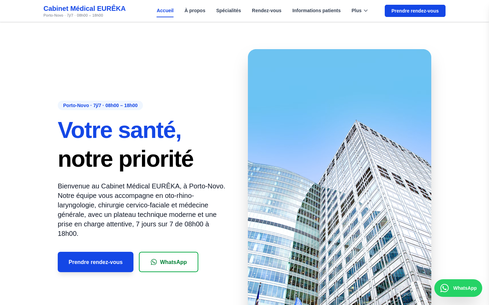
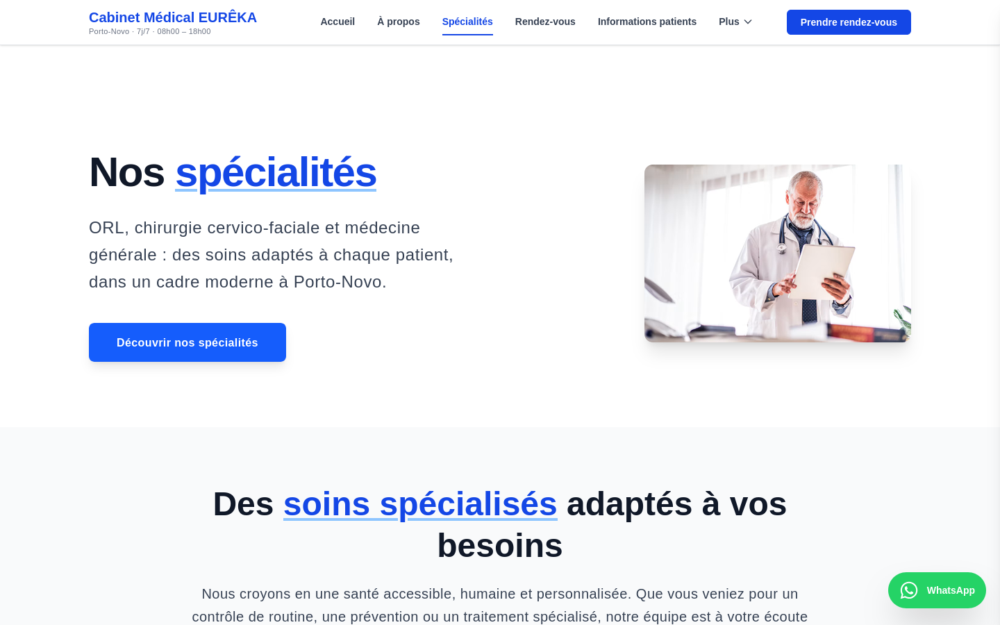
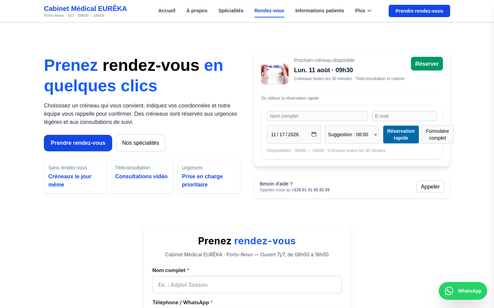
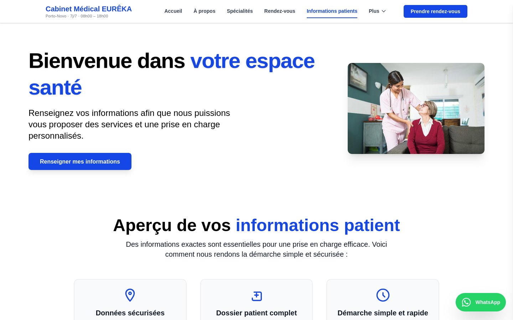
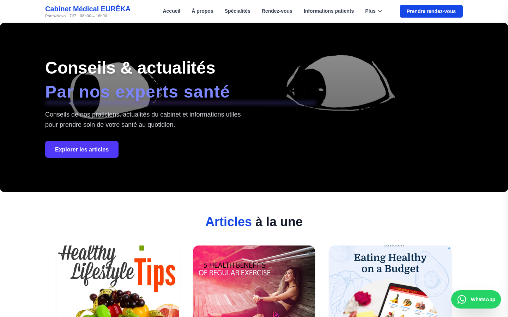
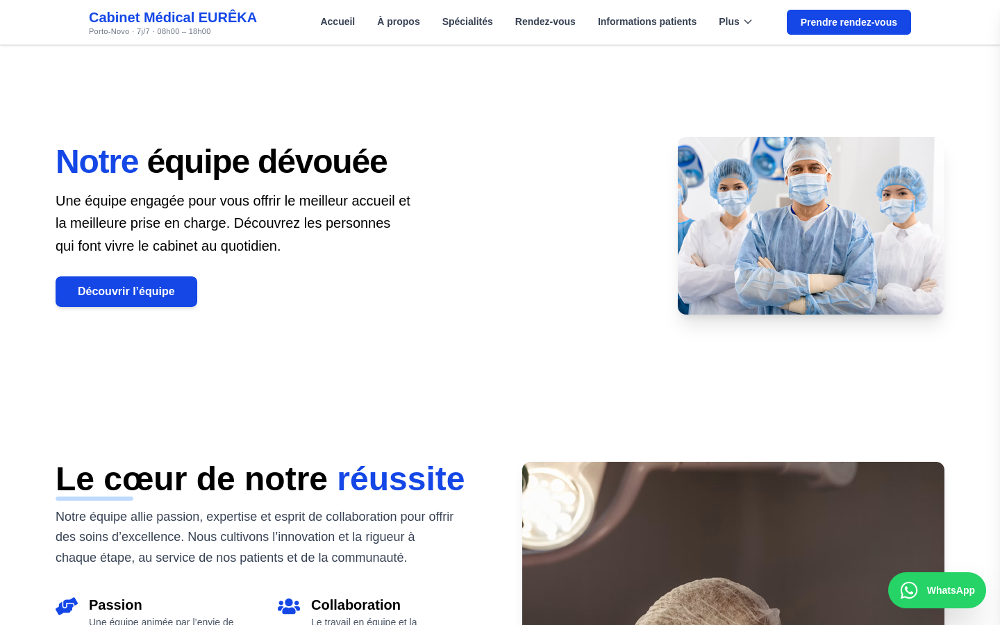
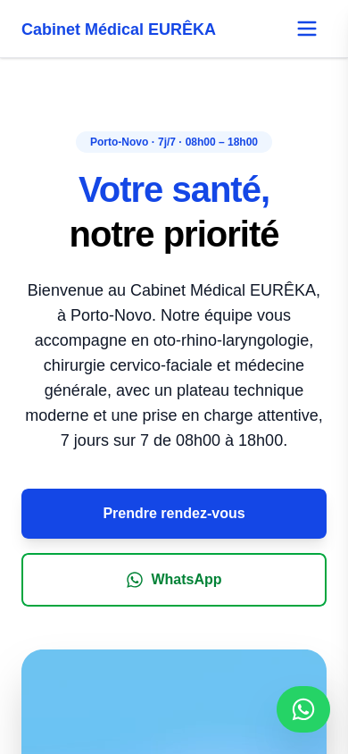

# Cabinet Médical EURÊKA — Porto-Novo, Bénin

Site vitrine du **Cabinet Médical EURÊKA**, à Porto-Novo (Bénin).
Interface 100 % en français, prise de rendez-vous avec récapitulatif **WhatsApp** pré-rempli, et déploiement statique sur **GitHub Pages**.

### 🔗 Aperçu en ligne

**https://t0b0i7.github.io/cabinet-medical-eureka/**

[](https://t0b0i7.github.io/cabinet-medical-eureka/)
[](https://nextjs.org/)
[](https://react.dev/)
[](https://tailwindcss.com/)

---

## 📸 Aperçu du site

| Accueil | Spécialités |
| :---: | :---: |
|  |  |

| Prise de rendez-vous | Espace patient |
| :---: | :---: |
|  |  |

| Blog santé | Notre équipe |
| :---: | :---: |
|  |  |

| Version mobile |
| :---: |
|  |

---

## ✨ Fonctionnalités

- **Prise de rendez-vous** : spécialité, date, créneau (08h00–18h00, toutes les 30 min), nom et téléphone.
- **Envoi WhatsApp** : le récapitulatif est pré-rempli et envoyé vers le **+229 01 41 60 83 39**.
- **Bouton WhatsApp flottant** présent sur tout le site.
- **Formulaire de contact** et coordonnées réelles du cabinet.
- **Urgences**, FAQ, blog santé, témoignages et présentation de l’équipe.
- **Espace patient** (démonstration) : informations personnelles, antécédents, ordonnances, documents, préférences de contact.
- **Design responsive** (mobile, tablette, ordinateur) avec animations Framer Motion / GSAP.
- **Personnalisation par URL** pour réutiliser le site pour un autre cabinet :
  `?clinique=...&ville=...&tel=...&email=...`

## 🩺 Spécialités et tarifs

| Spécialité | Tarif |
| --- | --- |
| Oto-Rhino-Laryngologie (ORL) | 10 000 à 15 000 FCFA |
| Chirurgie Cervico-Faciale | Sur devis |
| Médecine Générale & Suivi | 5 000 FCFA |

**Horaires :** ouvert 7j/7, de 08h00 à 18h00
**Adresse :** Porto-Novo, Bénin
**Téléphone / WhatsApp :** [+229 01 41 60 83 39](tel:+2290141608339)
**E-mail :** [contact@cabinet-eureka.bj](mailto:contact@cabinet-eureka.bj)

## 🧱 Stack technique

- **Next.js 15** (App Router, export statique `output: "export"`)
- **React 19**
- **Tailwind CSS 4**
- **Framer Motion**, **GSAP**, **Lenis** pour les animations
- **React Icons**, **Recharts**, **Swiper**

## 🚀 Démarrage local

```bash
npm install
npm run dev
```

Le site est disponible sur [http://localhost:3000](http://localhost:3000).

Pour générer l’export statique :

```bash
npm run build
# le site est généré dans le dossier out/
```

## 🌍 Déploiement GitHub Pages

Le site est publié depuis la branche **`gh-pages`** à l’adresse :
**https://t0b0i7.github.io/cabinet-medical-eureka/**

Pour republier après une modification :

```bash
npm run deploy
```

Cette commande reconstruit le site avec le `basePath` `/cabinet-medical-eureka`, puis pousse le dossier `out/` sur la branche `gh-pages`.

> `next.config.mjs` active l’export statique et le `basePath` uniquement lorsque `GITHUB_PAGES=true`.

## 📁 Structure du projet

```text
src/
├── app/                 # Pages (App Router)
├── components/          # Sections et composants (Accueil, Services, RDV, Blog…)
│   ├── Appointments/    # Formulaire et logique de rendez-vous
│   ├── Patient-Info/    # Espace patient
│   └── …
└── lib/
    ├── siteConfig.js    # Marque, spécialités, créneaux, message WhatsApp
    └── dateFr.js        # Formatage des dates en français
docs/screenshots/        # Captures utilisées dans ce README
scripts/deploy-pages.sh  # Script de déploiement GitHub Pages
```

## 📌 Notes

- Les images proviennent du template d’origine et d’Unsplash ; elles n’ont pas été modifiées.
- Les données de l’espace patient et du tableau de bord sont des **données de démonstration**.
- `patientdashboard` et `signup` redirigent automatiquement vers `/patient-info`.

---

© Cabinet Médical EURÊKA — Porto-Novo, Bénin.
